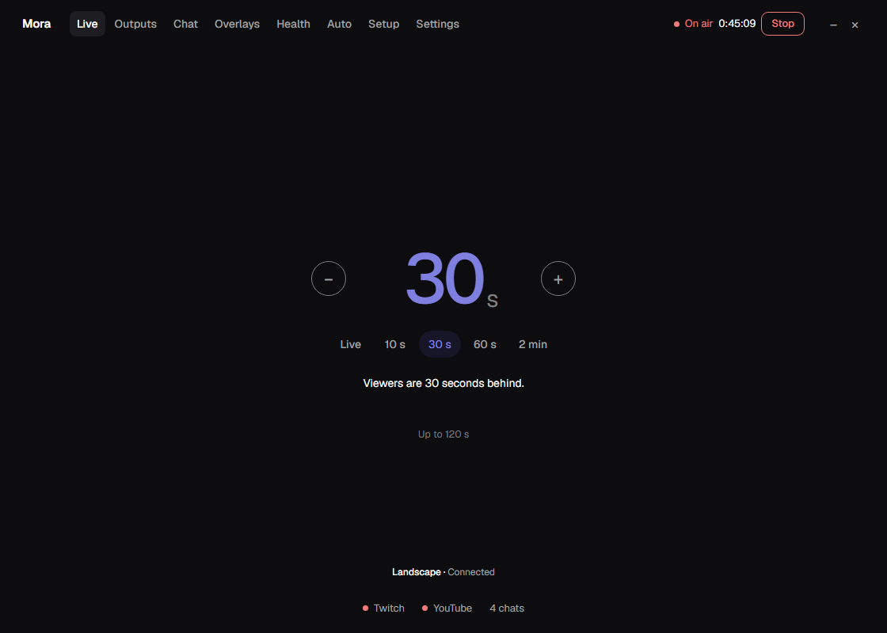
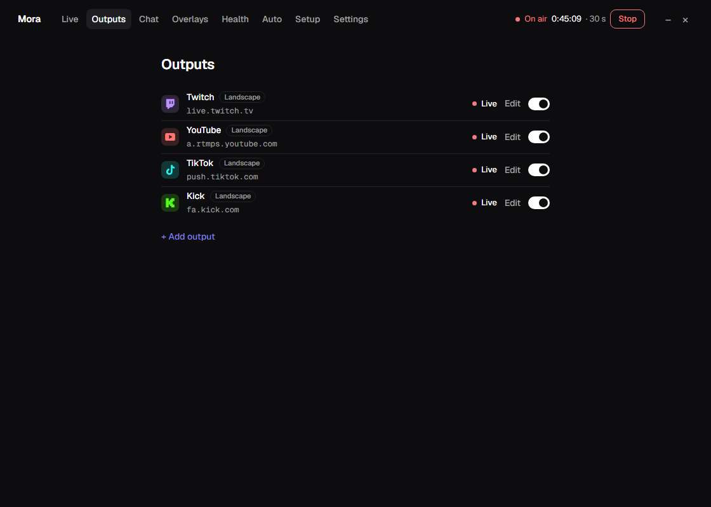
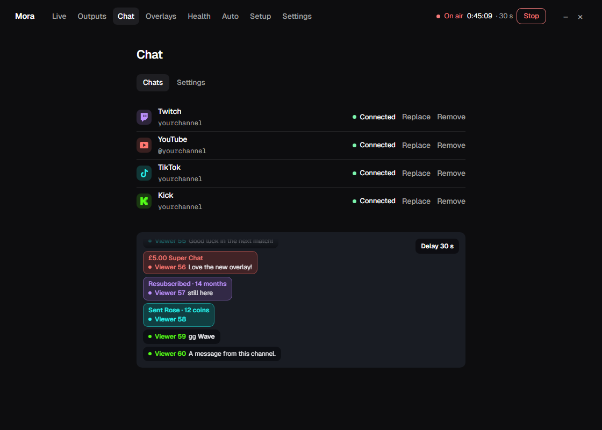

# Mora

Change your stream delay while you're live, and send one stream to every platform at once.

## Download

**[Download Mora for Windows](https://github.com/ahizechi/Mora/releases/latest)**, then run the
`setup.exe` installer from that page. Mora keeps itself up to date.

Windows 10 or 11, 64-bit. If Windows shows a blue "protected your PC" box, choose
**More info → Run anyway**.

## What it does

- **Live delay.** Add, change or remove up to 3 minutes of delay mid-stream, without restarting.
- **Multistream.** Up to 8 outputs: Twitch, YouTube, TikTok, Kick or any RTMP server. If one
  drops, the others keep going.
- **Vertical video.** Send a vertical stream to TikTok alongside your normal one, using the free
  Aitum Vertical plugin for OBS.
- **All your chat in one place.** Twitch, YouTube, TikTok and Kick chat together, in Mora, as an
  OBS dock or on screen.
- **Automatic delay.** Give each OBS scene its own delay, or raise it during VALORANT and
  League of Legends matches.
- **Your stream, untouched.** Mora doesn't re-encode anything, and your stream keys are stored
  only on your PC.

  
  
  

## Get started

1. Open Mora and go to **Setup**.
2. In OBS or Streamlabs, set the stream server and key to the ones Setup shows.
3. Add where you stream in **Outputs**.
4. Start streaming in OBS. Change the delay in Mora whenever you like.

Setup lists the few OBS settings Mora needs and has a full guide if you get stuck.

Good to know: adding delay replays the last few seconds to viewers, and removing it skips
ahead to live.

## Help

Something not working? [Open an issue](https://github.com/ahizechi/Mora/issues).
