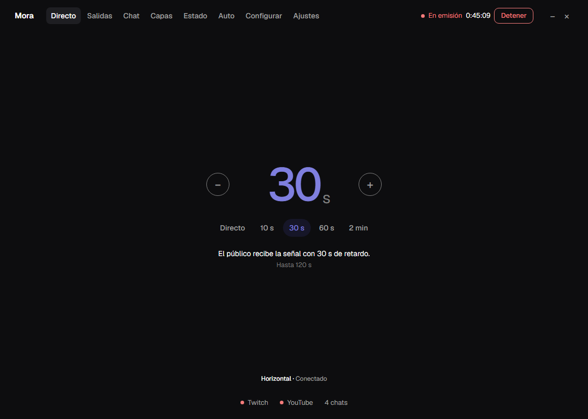
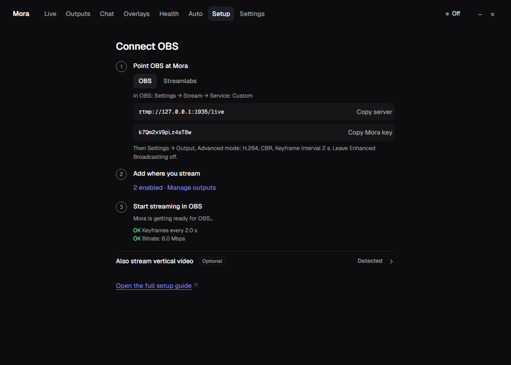
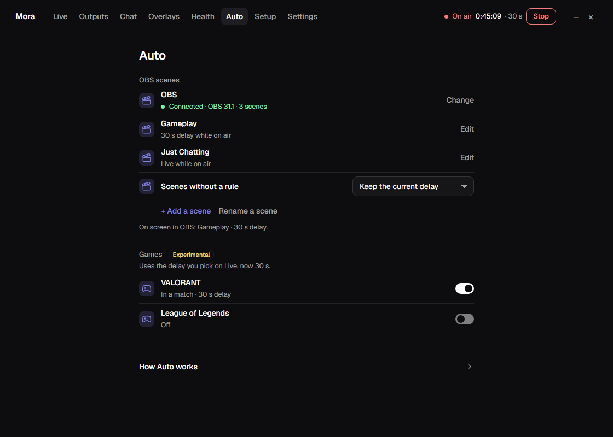

# Mora

**Change your stream delay while you're live, and send one stream to every platform at once.**
Free for Windows.

Mora sits between OBS and your streaming platforms. OBS sends one stream to Mora on your PC,
Mora holds it for as long as you choose, then sends it on to Twitch, YouTube, TikTok, Kick or
any RTMP server. You can add, change or remove the delay at any time without stopping your
stream.

```
OBS  ──►  Mora (holds it for the delay you choose)  ──►  Twitch · YouTube · TikTok · Kick · RTMP
```

<p>
  
  
</p>

## Download

**[Download Mora for Windows](https://github.com/ahizechi/Mora/releases/latest)**, then run the
`setup.exe` installer from that page. Mora is free and keeps itself up to date.

Windows 10 or 11, 64-bit. If Windows shows a blue "protected your PC" box, choose
**More info → Run anyway**.

## Features

### Change the delay while you're live

Pick **Live**, 10 s, 30 s, 60 s or 2 min, or nudge it in 2-second steps with − and +. The
longest delay is 2 minutes by default, and you can raise it to 3 in Settings.

- **Adding delay** replays the last few seconds, so viewers see them again.
- **Removing delay** jumps ahead to live, so viewers skip those seconds.
- **Undo** goes back to the delay you had before.
- **When you stop streaming,** Mora keeps sending the seconds viewers haven't seen yet, so your
  ending isn't cut off.

### Stream everywhere at once

Add up to 8 outputs: Twitch, YouTube, TikTok, Kick, or any RTMP or RTMPS server. Each output
has its own key and can be switched on or off while you're live. If one platform drops, the
others keep going and Mora keeps retrying the one that dropped.

<p>
  
  
</p>

### Vertical video for TikTok, Shorts and Reels

Stream a 9:16 vertical video alongside your normal one, using the free
[Aitum Vertical](https://github.com/Aitum/obs-vertical-canvas/releases) plugin for OBS. The same delay control drives both. Once
Mora is connected to OBS, **Set up in OBS** fills in Aitum's stream settings for you.

### TikTok through Streamlabs

If your TikTok account streams through Streamlabs, connect it in Mora and you don't need to
copy a key. Mora starts your TikTok LIVE when your delayed stream starts, and ends it once
viewers have seen the last delayed seconds. TikTok's stream key works too.

### All your chat in one place

Read Twitch, YouTube, TikTok and Kick chat together:
- in Mora;
- in a private OBS dock that only you can see, ahead of your delay;
- or on your stream as a browser source.

Super Chats, subscriptions, gifts, badges, and 7TV, BetterTTV and FrankerFaceZ emotes all show
up.

### Overlays

A **delay badge** shows viewers LIVE or the delay they actually have. It sits next to an
**on-stream chat** you can add to any OBS scene as a browser source.

<p>
  
  
</p>

### Automatic delay

Give each OBS scene its own delay: none on *Just Chatting*, 30 seconds on *Gameplay*. Mora
follows the scene that's on screen. For VALORANT and League of Legends, Mora can also apply your
delay when a match starts and restore the previous one when it ends. This game detection is
experimental.

### Shortcuts, alerts and health

- **Shortcuts:** keyboard shortcuts for adding delay, going back to live and each preset. They
  work with a Stream Deck too.
- **Alerts:** sounds and Windows notifications when an output drops or OBS stops sending.
- **Health:** shows whether each output and input is working and what to do if one isn't, plus
  a history of earlier streams.

### Five languages

English, Español, Français, Deutsch and Português (Brasil). Pick one in **Settings → General**.
It covers the window, alerts, the chat dock, the overlays and the setup guide.


### Your stream, untouched

- Mora doesn't decode or re-encode anything. Your platforms get exactly the video and audio OBS
  made.
- Your platform keys are stored on your PC in Windows Credential Manager and sent only to the
  services they connect to. OBS only ever gets Mora's own local key.
- Mora has no account to create and nothing to pay for.

## Get started

1. **Point OBS at Mora.** Open Mora's **Setup** tab. In OBS, go to Settings → Stream, set
   Service to *Custom*, and paste the server and key that Setup shows. Streamlabs Desktop works
   the same way.
2. **Turn off Enhanced Broadcasting.** In OBS, make sure **Enhanced Broadcasting** is off.
3. **Add where you stream.** Open **Outputs**, press **Add output**, pick the platform and paste
   its stream key. Mora tells you where each platform keeps its key.
4. **Go live.** Start streaming in OBS, then change the delay in Mora whenever you like.

The full setup guide opens from Setup or Settings, and also works offline.

## What you need

- Windows 10 or 11, 64-bit.
- OBS Studio or Streamlabs Desktop. Vertical video needs OBS 31.1 or newer.
- A stream key for each platform, or TikTok LIVE access through Streamlabs.
- Enough upload speed. Mora sends a full copy of your stream to each platform, so two platforms
  at 8000 kbps need about 17 Mbps of steady upload.

## Usage and privacy

Mora is free proprietary software for your own broadcasting use. No account, subscription or
licence key is required. Share the [official download link](https://github.com/ahizechi/Mora/releases/latest)
with others; redistribution and modification of Mora itself are restricted by the [licence](LICENSE).
Third-party components keep their own [licences and notices](THIRD-PARTY-NOTICES.txt).

See the [privacy notice](PRIVACY.md) for local storage, platform connections, updates and support reports.
